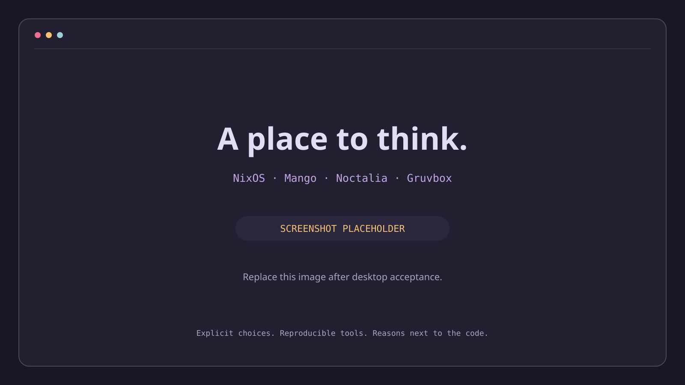

<div align="center">

# Dotfiles

**A personal workspace, expressed in Nix.**

Umbriel · Mango fallback · Noctalia · Look · Stylix · Gruvbox · Fish · Neovim · Vim

[About](#about) · [Structure](#layoutstructure) · [Install](#install--apply) · [Reference](#quick-references)



*Placeholder, not a capture of the running desktop.*

</div>

## About

A modular workspace for NixOS, macOS with nix-darwin, Linux with Home Manager,
and WSL. Shared profiles describe workflows; hosts supply identity, platform and
hardware. Nix is annotated directly, with an Indonesian handbook explaining the
reasons and maintenance exercises. No Markdown/Org generation step is required.

The ThinkPad defaults to Umbriel with Mango as a fallback, Noctalia Greeter,
Noctalia's panel/lockscreen, Look's launcher/clipboard,
Stylix Gruvbox, and TLP/tlp-pd. Project toolchains come from standalone devShells
with direnv. Podman services are isolated in the Bun services template.

## Layout/Structure

```text
flake.nix                       Inputs and flake-parts per-platform outputs
hosts/                          Registry, host identity and device configuration
profiles/                       Shared CLI, development, GUI, creative and gaming choices
modules/home-manager/programs/  Alphabetical configured applications
modules/home-manager/services/  User service integrations
modules/home-manager/desktop/   Compositor and desktop session integrations
modules/home-manager/appearance/ Stylix targets, adapters and theme switching
modules/nixos/, modules/darwin/ System integrations for their respective OS
packages/                       Shared nvf editor and pinned binary application packages
lib/                            Host construction, native sources and command dispatcher
devshell/                       Bun with services, Go and Rust templates
themes/                         Shared schemes, fonts, icons and cursor
tests/                          Configuration, runtime and command contracts
docs/                           Indonesian handbook and verification evidence
secrets/                        Encrypted SOPS data; private identities stay outside Git
```

Programs use upstream Home Manager options where available. An ordinary package
belongs in a profile's `home.packages`; it does not need its own enable module.
Profiles are reusable selections, not machine identities. Tmux and Vim retain
independent native sources for copying to machines without Nix.

## Prerequisites

Nix with flakes/nix-command, Git, and internet for uncached inputs. Supported
build platforms are `x86_64-linux`, `aarch64-linux`, and `aarch64-darwin`.
Nixpkgs 26.11 removed Mac Intel support; no unsupported-platform bypass is used.
Individual applications have narrower platform support: consult [the application
notes](docs/applications.md). Evaluation is not a cross-platform runtime test.

## Install & Apply

Review [installation and recovery](docs/installation.md) first. Example hosts use
`example` and must be adapted to the real identity before activation. Preserve
existing stateVersion values and generate your own hardware configuration.

```sh
nix develop                 # pinned Just, nh, formatters and shell tools
just                        # list recipes
just check
just build thinkpad-x13
just build ubuntu-x86_64-linux
just diff thinkpad-x13
# After reviewing the generation and HOME ownership:
just apply thinkpad-x13
```

Plain Nix remains available: `nix build .#nixosConfigurations.thinkpad-x13.config.system.build.toplevel --no-link`.
Apply checks platform, system type and username. Privileged system activation
uses normal local authentication through nh. Building does not activate a profile.

## Known Hosts

| Configuration | Platform | Purpose |
| --- | --- | --- |
| `thinkpad-x13` | x86_64-linux, NixOS | Existing AMD ThinkPad workstation |
| `macos-example` | aarch64-darwin | nix-darwin with shared CLI/development |
| `ubuntu-{x86_64,aarch64}-linux` | Linux, Home Manager | Generic distro examples |
| `ubuntu-wsl-{x86_64,aarch64}-linux` | Linux, Home Manager | Existing Ubuntu WSL examples |
| `nixos-wsl-{x86_64,aarch64}-linux` | NixOS-WSL | NixOS distribution under WSL |

Braces above abbreviate two explicit output names; pass one real name to Just.
The old `portable` output has been replaced by the Ubuntu examples without aliases.

## Quick References

| Task | Command or guide |
| --- | --- |
| Select programs or add a host | [Configuration](docs/configuration.md), [installation](docs/installation.md#add-a-host) |
| Enter a project shell | `nix flake init -t /path/to/dotfiles#go`; review, then `direnv allow` |
| Toolchains and services | [Development](docs/development.md) |
| Switch prebuilt theme | `dotfiles-theme set gruvbox-light`; [appearance](docs/themes.md) |
| Power profiles and heavy work | `just power balanced`, `dotfiles-boost command`; [performance](docs/performance.md) |
| Fast Nix build on ThinkPad | `just build-fast thinkpad-x13` |
| Update deliberately | `just update nixpkgs` or `just update` |
| Preview cleanup | `just clean` |
| Execute reviewed cleanup | `just clean-apply` (retain five generations and 30 days) |
| Format source | `just fmt` (generated hardware/device files excluded) |
| Application decisions | [Applications](docs/applications.md) |
| Desktop, SuperKey, shelf and capture | [Desktop guide](docs/desktop.md) |
| Desktop migration evidence | [Traceability](docs/artifacts/desktop-migration.md) |
| Test/build limitations | [Validation](docs/artifacts/validation.md) |

## Notes

Secrets, SDKs, projects, account state and device authorisation stay writable and
outside the repository. Syncthing pairing is manual; its UI is localhost-only.
Zotero is omitted by default. Noctalia does not generate app themes or record
clipboard history. Look is the clipboard owner. Disk migration tools are not enabled.

Keep private backups and existing generations until actual host acceptance.
Build success does not establish desktop, power, audio or physical-device behaviour.

## Inspiration

[Ryan Yin](https://github.com/ryan4yin/nix-config) ·
[Misterio's starter configs](https://github.com/Misterio77/nix-starter-configs) ·
[Foundry](https://github.com/Misterio77/Foundry) ·
[Calsjunior](https://github.com/Calsjunior/dotfiles) ·
[natsukium](https://github.com/natsukium/dotfiles) ·
[Waldir Borba](https://github.com/waldirborbajr/nixos-config)

Licensed under [MIT](LICENSE).

Desktop changes can be verified with `just desktop-smoke`; use the
[immutable cutover guide](docs/cutover.md) for audited HOME relocation and recovery.
